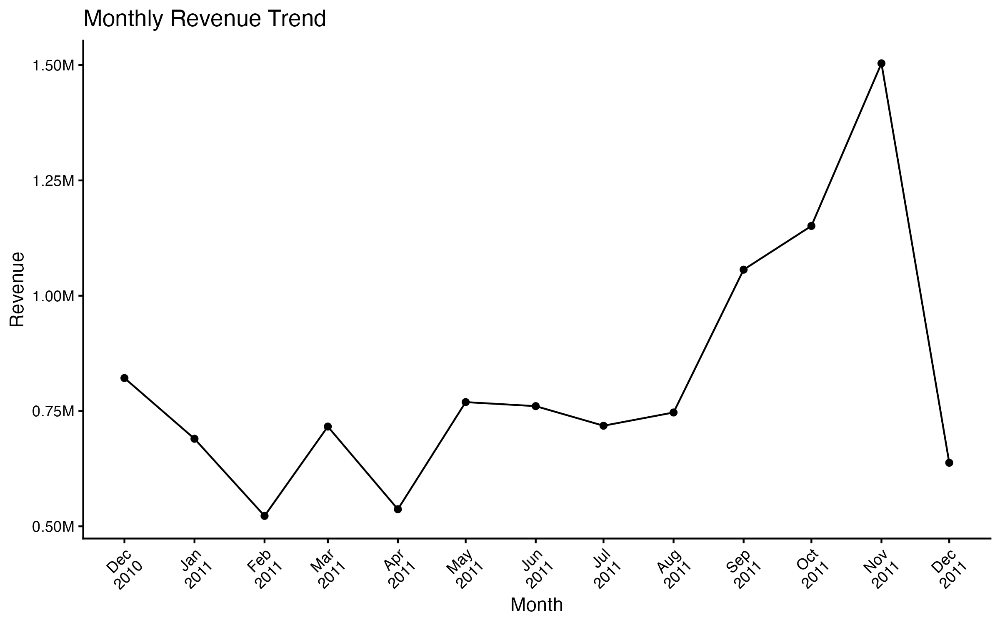
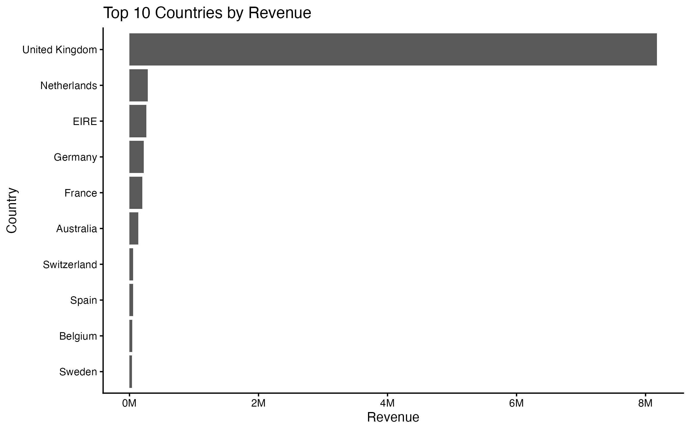
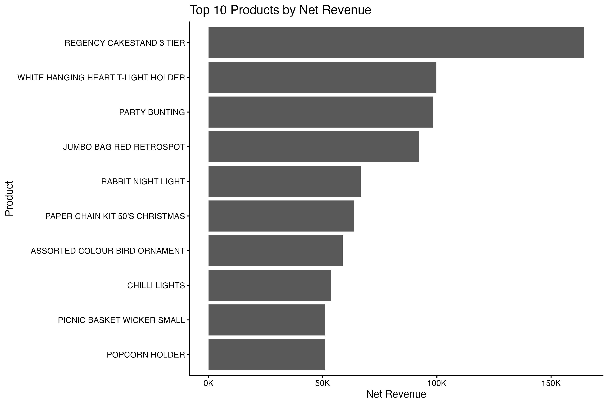
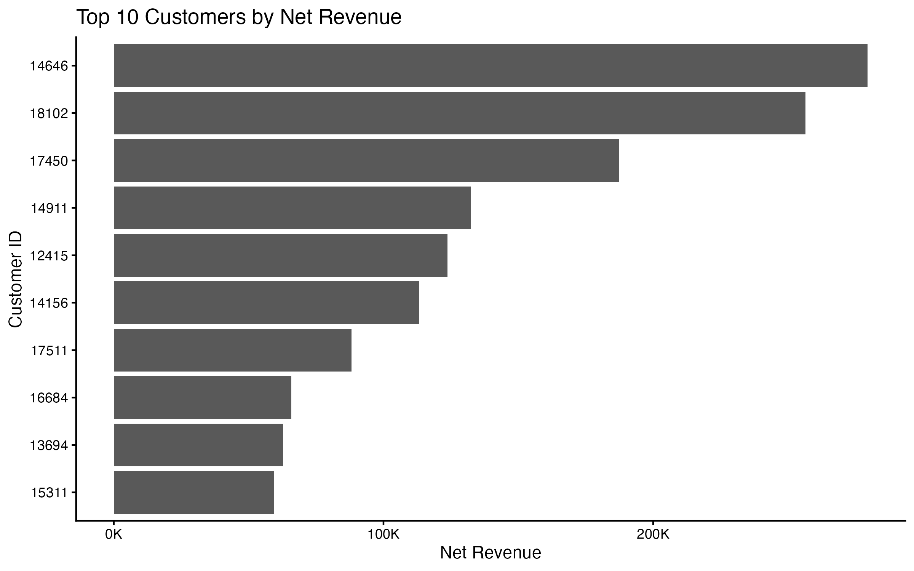

# Retail Sales Data Analysis

## Project Overview

This project analyzes retail transaction data to identify sales trends,
revenue drivers, customer activity, and product performance.

The analysis follows an end-to-end workflow from raw data auditing and
cleaning to business analysis, visualization, and result validation.

R was used for data cleaning, analysis, and visualization. The cleaned
dataset was then imported into MySQL, where the main analytical results
were independently reproduced and compared with the R results.

The project focuses on producing reproducible analysis, clearly defined
business metrics, and practical business insights while documenting data
quality issues, analytical decisions, and limitations.

## Business Questions

This project addresses five business questions:

1. How has sales performance changed over time?
2. Which countries generate the strongest sales performance?
3. Which products contribute the most to sales performance?
4. How concentrated is revenue among customers?
5. What are the most important business insights from the analysis?

## Dataset

The project uses the `Online Retail.xlsx` transaction dataset.

Each row represents a retail transaction and includes information such as:

- Invoice number
- Product code and description
- Quantity
- Invoice date
- Unit price
- Customer ID
- Country

The raw dataset contains both normal sales transactions and records that
require additional review, including cancellations, negative quantities,
missing customer identifiers, duplicate rows, and non-positive prices.

A cleaned analytical dataset, `sales_clean.csv`, was created in R and used
as the common source for both the R and MySQL analyses.

## Data Cleaning

The raw transaction data required several cleaning and validation steps
before it could be used for analysis.

Key cleaning decisions included:

- Removing exact duplicate rows.
- Retaining valid cancellation transactions where the invoice number begins
  with `C` and quantity is negative.
- Excluding non-cancellation transactions with non-positive quantities
  because they primarily represented inventory adjustments rather than
  customer sales.
- Excluding transactions with non-positive unit prices.
- Excluding accounting adjustment records such as `Adjust bad debt`.
- Preserving transactions with missing `CustomerID` values for overall
  sales analysis.
- Calculating `Revenue` as `Quantity * UnitPrice`.

During product-level quality assurance, the initial cancellation-handling
approach was found to overstate revenue because cancellation transactions
had been removed while the original positive sales were retained.

The methodology was revised so that valid cancellations were retained as
negative revenue. After cleaning, the final dataset contained 534,128 rows
and total net revenue of approximately 9.74 million.

## Key Performance Indicators

The cleaned dataset was used to calculate four core business KPIs:

| KPI | Value |
|---|---:|
| Net Revenue | 9,737,069 |
| Sales Orders | 19,959 |
| Active Customers | 4,338 |
| Average Order Value | 487.85 |

Net Revenue includes valid cancellation transactions as negative revenue.

Sales Orders and Active Customers are calculated using non-cancellation
sales transactions.

Average Order Value is calculated as Net Revenue divided by the number of
Sales Orders.

## Key Findings

### 1. Late-Year Growth Was Driven by Order Volume and Customer Activity

From September to November 2011:

- Net Revenue increased by approximately 43.1%.
- Sales Orders increased by approximately 50.7%.
- Active Customers increased by approximately 31.4%.
- Average Order Value decreased by approximately 5.1%.

This indicates that late-year growth was driven primarily by more orders
and greater customer activity rather than higher revenue per order.

### 2. Revenue Was Highly Concentrated in the UK

The United Kingdom generated approximately 84.0% of total net revenue.

The top five countries together accounted for approximately 93.9% of
total net revenue, showing that business performance was heavily
concentrated in a small number of markets.

### 3. Revenue and Sales Volume Identified Different Leading Products

`REGENCY CAKESTAND 3 TIER` generated the highest net revenue at
approximately 164,459.

`POPCORN HOLDER` generated the highest net sales volume with 56,427 units.

Only five products appeared in both the top 10 by net revenue and the
top 10 by net quantity, showing that product performance should be
evaluated using both revenue and sales volume.

### 4. Revenue Was Concentrated Among High-Value Customers

The top 10 active customers generated approximately 16.5% of
active-customer net revenue.

The top 1% of active customers, representing 44 customers, generated
approximately 30.0% of active-customer net revenue.

This suggests that a relatively small group of customers contributed a
disproportionately large share of revenue.

## Visualizations

### Monthly Performance



### Country Performance



### Product Performance



### Customer Performance



## R and MySQL Validation

The main analytical results were independently reproduced in MySQL using
the cleaned dataset created in R.

Key results matched across both tools:

| Metric | R | MySQL |
|---|---:|---:|
| Net Revenue | 9,737,069.014 | 9,737,069.014 |
| Sales Orders | 19,959 | 19,959 |
| Active Customers | 4,338 | 4,338 |
| Average Order Value | 487.85 | 487.85 |
| UK Revenue Share | 84.0% | 84.0% |
| Top Five Country Share | 93.9% | 93.9% |
| Product Top-10 Overlap | 5 | 5 |
| Top 10 Customer Share | 16.5% | 16.5% |
| Top 1% Customer Share | 30.0% | 30.0% |

During customer-level validation, a floating-point precision issue was
identified in R for net revenue values extremely close to zero.

The R validation logic was updated to use `dplyr::near()` when testing
for zero net revenue. After this adjustment, the customer-level QA
results matched the MySQL results.

This cross-validation increased confidence that the main analytical
results were reproduced consistently across both R and SQL workflows.

## Project Structure

```text
01_Retail_Sales_Analysis/
├── README.md
├── 01_data/
│   ├── 01_raw/
│   └── 02_processed/
├── 02_R/
│   ├── 01_data_cleaning.R
│   ├── 02_monthly_analysis.R
│   ├── 03_country_analysis.R
│   ├── 04_product_analysis.R
│   └── 05_customer_analysis.R
├── 03_figures/
│   ├── monthly_revenue_trend.png
│   ├── country_revenue_top10.png
│   ├── product_revenue_top10.png
│   └── customer_revenue_top10.png
├── 04_report/
│   ├── analysis_notes.md
│   └── project_plan.md
├── 05_SQL/
│   ├── 01_database_setup.sql
│   ├── 02_data_import.sql
│   ├── 03_kpi_analysis.sql
│   ├── 04_monthly_analysis.sql
│   ├── 05_country_analysis.sql
│   ├── 06_product_analysis.sql
│   └── 07_customer_analysis.sql
└── 01_Retail_Sales_Analysis.Rproj
```

## Tools

- **R** — Data auditing, cleaning, analysis, validation, and visualization
- **tidyverse** — Data transformation and analysis
- **ggplot2** — Data visualization
- **MySQL** — SQL-based analysis and cross-validation
- **Excel** — Raw source data format
- **Git / GitHub** — Version control and portfolio publishing
- **Markdown** — Project documentation and reporting

## Analytical Limitations

This analysis has several limitations that should be considered when
interpreting the results:

- December 2011 contains only partial-month data and should not be compared
  directly with complete months.
- Transactions with valid `CustomerID` values represent approximately 85%
  of total net revenue, so customer-level analysis does not cover all sales.
- Thirty-three CustomerID values appeared only in cancellation transactions
  and were excluded from the active-customer population used for customer
  concentration analysis.
- The dataset does not explicitly confirm the transaction currency, so
  revenue is reported without assigning a currency symbol.
- The analysis is descriptive and diagnostic and does not establish causal
  relationships.

  ## How to Reproduce the Analysis

### R Analysis

1. Open `01_Retail_Sales_Analysis.Rproj` in RStudio.
2. Place the raw `Online Retail.xlsx` dataset in:

   `01_data/01_raw/`

3. Run the R scripts in the following order:

   1. `02_R/01_data_cleaning.R`
   2. `02_R/02_monthly_analysis.R`
   3. `02_R/03_country_analysis.R`
   4. `02_R/04_product_analysis.R`
   5. `02_R/05_customer_analysis.R`

4. The cleaning script creates the processed dataset:

   `01_data/02_processed/sales_clean.csv`

5. The analysis scripts reproduce the analytical results and save the
   final figures in:

   `03_figures/`

### MySQL Analysis

Before importing the processed CSV, enable local file loading in MySQL:

```sql
SET GLOBAL local_infile = ON;
```

After generating `sales_clean.csv`, run the SQL scripts in the following
order:

1. `05_SQL/01_database_setup.sql`
2. `05_SQL/02_data_import.sql`
3. `05_SQL/03_kpi_analysis.sql`
4. `05_SQL/04_monthly_analysis.sql`
5. `05_SQL/05_country_analysis.sql`
6. `05_SQL/06_product_analysis.sql`
7. `05_SQL/07_customer_analysis.sql`

The SQL workflow recreates the major KPIs and business analyses so that
the results can be compared with the R output.